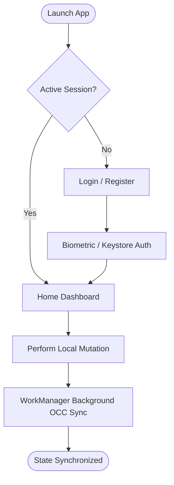
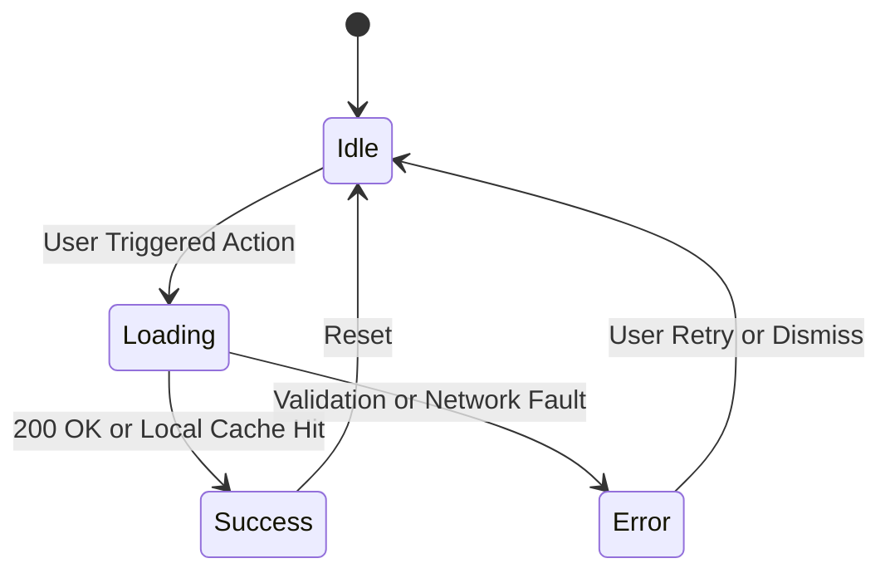

# Product Requirement Document (PRD): Modern Mobile Solution Scaffold
**Status**: Draft / In-Review  
**Architecture Spec**: Clean / Hexagonal Architecture  
**Target Platforms**: Native Mobile (Kotlin Multiplatform / Compose) & Web Companion  

---

## 1. Executive Summary & Problem Statement
Provide a seamless offline-first native experience.

---

## 2. Target Personas & Jobs-To-Be-Done (JTBD)
- **Alex (Impatient Power User - wants zero-latency, keyboard/gesture efficiency)**
- **Sam (Non-Technical Novice - needs intuitive affordances, zero jargon)**
- **Jordan (A11y & Screen-Reader User - requires 48dp tap targets, dynamic text scaling)**

---

## 3. User Flows & State Machine Specifications

### Primary Navigation Flow

### State Machine Lifecycle

---

## 4. Key Functional Requirements
1. **Authentication & Session Bootstrap**: High-fidelity native implementation adhering to `.harness/design-tokens.json`.
2. **Core Feature Walkthrough**: High-fidelity native implementation adhering to `.harness/design-tokens.json`.
3. **Offline Mutate & Auto-Sync**: High-fidelity native implementation adhering to `.harness/design-tokens.json`.

---

## 5. Non-Functional & Native Quality Requirements
- **60/120 Hz Native Fluidity**: Zero dropped VSYNC frames, Jank Frame Rate $< 1.0\%$ verified via Android `dumpsys gfxinfo framestats`.
- **Offline-First Synchronization**: Local persistence backed by Field-Level Optimistic Concurrency Control (OCC) and mutation journals.
- **Cybersecurity & Hardening**: STRIDE threat modeling passed, zero plaintext secrets, Android Keystore biometrics.
- **Design System Enforcement**: Must pass `.harness/linter.py` with zero raw hex color codes and strict 4dp grid alignment.
