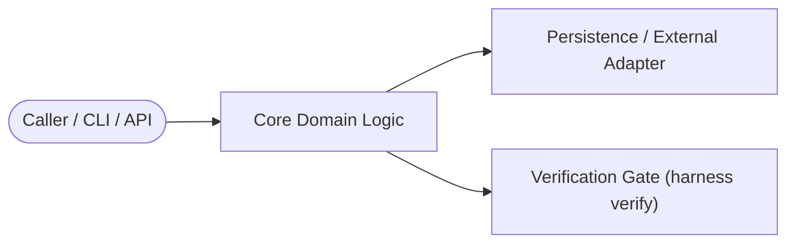

# Technical RFC: Khoros v3.1 Autonomous Capability Synthesis, Library Hygiene, and CLI Migration
**Status**: Proposed  
**Profile**: `python`  
**Orchestration Tier**: Tier 2 (Multi-Step Architecture & Implementation)  

---

## 1. Context & Problem Statement
Implement autonomous tool synthesis, evolutionary skill grammar, risk-gated admission, cognitive context budgeting, generational GC, and rename CLI from harness to khoros with backwards-compatible symlinks.

---

## 2. Proposed Architecture & Boundaries

### Key Design Decisions
1. **Separation of Concerns**: Core domain logic remains decoupled from I/O and presentation adapters.
2. **Backwards Compatibility**: Existing interfaces and schemas migrate cleanly without breaking callers.
3. **Failure Modes & Rollback**: All state mutations are atomic or guarded by fencing tokens.

---

## 3. Task Breakdown & Verification Plan
- [ ] Define interfaces and data contracts.
- [ ] Implement core logic and unit tests.
- [ ] Run `harness verify` and independent `@critic` review.
