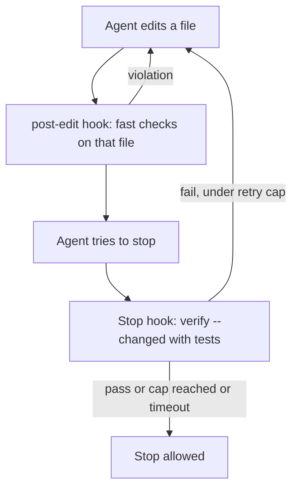

# RFC: Khoros v4, an evidence-driven harness

- Status: proposed
- Branch: `feat/khoros-v4`
- Supersedes the factory-style workflow in [khoros-v3-1.md](khoros-v3-1.md)

## 1. Problem

Khoros v3.1 described itself as a self-improving software factory. Our own benchmark and an architecture
audit show that, on the work agents actually do, it did not change outcomes and cost more.

### 1.1 Benchmark evidence (`bench/results/*`, model fixed to Sonnet, Claude Code 2.1.303)

All costs are Claude Code list-price estimates from token usage, not a bill. "Cost ratio" is the geometric
mean of per-task ratios against vanilla; see `bench/HYPOTHESES.md` for the analysis rules.

| Run | Arms (solved) | Result |
|---|---|---|
| `hard-sonnet` (6 tasks, 3 trials) | vanilla 17/18, khoros 18/18 | Solve-rate difference inconclusive (CI +0 to +22 pp: vanilla already solves 94%). Cost ratio 1.11x (1.03x to 1.21x). |
| `placebo-hard-sonnet` (6 tasks, 2 trials) | vanilla 12/12, placebo 11/12, khoros 11/12 | Placebo and khoros both -8 pp (CI -33 to +0). Cost ratio: placebo 1.17x (0.98x to 1.34x, not significant), khoros 1.22x (1.10x to 1.38x). |
| `lean-hard-sonnet` (6 tasks, 2 trials) | vanilla, khoros, khoros-lean all 12/12 | Cost ratio 1.06x (0.95x to 1.21x) and 1.05x (0.93x to 1.19x): not significant. |
| `phase2-s1` (19 sqlglot tasks, pilot) | vanilla 7/45 (16%), khoros-factory 8/48 (17%), placebo 9/43 (21%) | Solve-rate CIs include zero for both arms. Cost ratio for the factory 1.18x (1.10x to 1.26x), latency ratio 1.61x (1.14x to 2.03x). The report itself says there is not enough data (fewer than 2 runs per task and arm) for significance. |

What this supports, and what it does not:

- Khoros never measurably raised solve rate. The regression suites (`core`, `hard`) cannot show help because
  vanilla already solves 94-100%; the phase-2 pilot is underpowered.
- Cost overhead was 1.05x to 1.22x in the regression suites, and the factory workflow added about 1.6x latency.
- A placebo `CLAUDE.md` of similar length did as well as Khoros on solve rate, so the instruction text itself
  is not what produced any effect.
- Left free to choose, the agent used only `verify` (63 of 63 runs in the first suite per `HYPOTHESES.md`;
  58-83% of runs in the reports above). Triage, spec, task, claim, submit and approve were used in 0% of
  runs unless a preamble forced them (`khoros-factory`: 65%).

### 1.2 Audit findings (measured on the v3.1 tree)

- `verify` ran `py_compile`, two secret regexes, a Mermaid check and a mobile design-token linter. Unit tests
  were not part of the default. In an empty directory it passed a JS file containing a syntax error.
- The hooks and plugin were in Antigravity format. The one Stop hook only recovered expired leases and always
  answered `allow`. The Khoros plugin was not installed in Claude Code, so only the prose in `CLAUDE.md` reached the agent.
- `khoros status` printed a cache-hit rate computed from `record_usage` calls with hardcoded token counts. It
  was never measured.
- The microkernel graph, event store, worktree manager, capsules, kaizen and skill mining were exercised only
  by tests; roughly 75 KB of Python (estimate from file sizes). Docs described AST jigs at write time, a
  causal elimination DAG and a bwrap sandbox, none of which was wired. See `.harness/EXPERIMENTAL.md`.
- Five overlapping instruction files, stale model ids (Claude 3.7 / 3.5) and project-specific mobile code
  inside a core that claimed to be task-agnostic.

Not verified: the audit inferred from file formats that the plugin does not load in Claude Code; it did not
run a live load test.

## 2. State of the art

Sources the audit relied on, with how I could check them. [S] = primary source opened; [2] = secondary
source or snippet only; [I] = inference.

| Finding | Source | Status |
|---|---|---|
| Rules that must hold belong in hooks; a Stop hook with exit 2 and stderr sends Claude back to work; keep CLAUDE.md under about 200 lines and only non-inferable facts; skills load by progressive disclosure; "delegate for a better answer" is dead advice, a fresh-context reviewer is not | [Claude Code best practices](https://code.claude.com/docs/en/best-practices) | [S] |
| Context files raise cost by over 20% on average without improving success; repository overviews did not help; any gain should be rigorously evaluated | [ETH Zurich, arXiv 2602.11988](https://arxiv.org/abs/2602.11988) | [S] abstract; per-model numbers [2] |
| Terminal-Bench 2.0 52.8% to 66.5% with the model fixed and only the harness changed; changes include a pre-completion verification pass and loop detection. No per-component ablation except reasoning budget | [LangChain, Improving Deep Agents with harness engineering](https://www.langchain.com/blog/improving-deep-agents-with-harness-engineering) | [S] |
| Harness choice moves tokens per solved task up to 40x while pass-rate gaps are 0-8 pp, mostly CIs including zero; preliminary, small sample | [The Scaffold Effect in Coding Agents, arXiv 2607.22585](https://arxiv.org/abs/2607.22585) | [S] abstract |
| Long-running work: initializer session, JSON feature list with pass flags, one feature per session, commit each, start-of-session read of progress and git log; end-to-end testing beat unit tests alone (no numbers given) | [Anthropic, effective harnesses for long-running agents](https://www.anthropic.com/engineering/effective-harnesses-for-long-running-agents) | [S] |
| Smallest set of high-signal tokens; start minimal and add instructions from observed failures | [Anthropic, effective context engineering](https://www.anthropic.com/engineering/effective-context-engineering-for-ai-agents) | [S] |
| Repo as system of record, structural linters, agent-reviews-agent, recurring doc gardening; greenfield, vendor-authored, no ablation | [OpenAI, Harness engineering](https://openai.com/index/harness-engineering) via [rywalker.com summary](https://rywalker.com/research/openai-harness) | [2]: the post returned 403 and was not read. Claims such as "linters carry remediation text" are unconfirmed |
| Expert personas help alignment tasks and hurt coding | [The Register on a March 2026 preprint](https://www.theregister.com/2026/03/24/ai_models_persona_prompting/) | [2] preprint not opened |
| LLMs degrade with input length | [Chroma, Context Rot](https://research.trychroma.com/context-rot) | [2] snippet only |
| Spec-driven tooling overhead and drift | blog-level criticism (e.g. Scott Logic on Spec Kit) | [2]; no controlled study found |

Order of evidence strength, in my judgment [I]: (1) a blocking verification gate and (2) short non-inferable
context are the best supported; durable state for long tasks and fresh-context review have vendor guidance but
no numbers; automated self-improvement and doc gardening have the weakest evidence. No isolated ablation of a
single harness feature was found, which is why v4 is evaluated by us (section 6).

## 3. Design

1. **Gate (enforced).** `bin/khoros-gate stop` runs `verify --changed`, tests included, when the working tree
   has changed code files. Failure writes an actionable report to stderr and exits 2, so Claude continues.
   `bin/khoros-gate post-edit` runs fast static checks on the single edited file and nudges once when a file
   has been edited 8 or more times in a session. `verify` now runs the project's tests (auto-detected, or
   `verify.test_command`) and says "skipped: reason" for every check that did not apply. Every failure carries
   file:line, what failed and how to fix or reproduce it.
2. **Minimal always-loaded context.** `CLAUDE.md` of at most 40 lines: commands and rules that cannot be
   inferred. No architecture overview, no personas.
3. **Opt-in long-task skill.** `plugin/skills/long-task/SKILL.md` for multi-session or many-feature work:
   durable state in the blackboard (`task create/claim/submit/approve`, `status`), one task at a time, a
   commit per task, a start-of-session ritual. Small tasks never load it.
4. **Single reviewer.** One read-only `khoros-reviewer` agent (Read, Grep, Glob, Bash) that reviews a diff
   against the request in a fresh context and reports defects with file:line. It replaces five role agents.
5. **Honest telemetry and docs.** Invented `record_usage` calls are removed; `status` prints "not measured"
   instead of a cache-hit rate it did not observe. Docs mark unwired modules as experimental.

Interfaces (flags, config keys, hook layout) are specified in the design contract for the v4 branch and
implemented by the gate and context workstreams; this RFC does not restate them.

## 4. Removed or demoted

| Item | Change | Why |
|---|---|---|
| Triage, spec, task, claim, submit, approve as the default path in `CLAUDE.md` | Moved to the opt-in long-task skill | Used by 0% of free-choice runs; 1.6x latency and 1.18x cost when forced, no solve-rate gain; `approve` was self-approval |
| Five role agents, personas | Replaced by one reviewer | Delegation "for a better answer" has no support; persona prompting reported to hurt coding [2] |
| Antigravity-format `plugin/hooks.json` | Replaced by Claude Code hooks (Stop, SubagentStop, PostToolUse) | The old one never blocked anything in Claude Code |
| Governor token budget and cache-hit "Andon" | Marked experimental; invented telemetry removed | Inputs were constants |
| Kernel graph, event store, worktree manager, capsules, kaizen, skill mining, sandbox, GC | Demoted to experimental | No caller outside tests, no benchmark evidence |
| Claims about AST jigs, causal DAG, bwrap sandbox, mathematical discipline | Corrected or flagged in README and wiki | Not true of the code |
| Stale model ids and cache-breakpoint figures for Claude 3.7 / 3.5 | Removed from docs | Out of date; not our evidence to assert |

Nothing was deleted from the tree by this RFC; demoted code stays under `.harness/` with tests.

## 5. Risks and mitigations

| Risk | Mitigation |
|---|---|
| **Gate loops**: the Stop hook keeps blocking on a failure the agent cannot fix | Retry cap: after `verify.max_stop_blocks` (default 3) consecutive blocks the gate allows stop and warns that verification is failing; the counter resets on a pass |
| **Slow test suites** stall every stop | Test command has its own timeout (`verify.test_timeout`, default 240 s, hook timeout 300 s); on timeout the gate reports it and allows stop. `verify --changed` scopes static checks; `post-edit` runs static checks on one file only |
| **False positives** (a flaky or unrelated failing test blocks correct work) | Retry cap above; reports include the failing output tail so the agent can say the failure is unrelated; escape hatch `KHOROS_GATE=off` or `verify.gate: off` |
| **Silent skipping** gives false assurance, as in v3.1 | Every skipped check prints "skipped: reason" |
| Gate adds cost on small edits | Gate is silent when no code files changed (docs and `*.md` excluded); cost is measured, not assumed (section 6) |
| The gate may simply not help, like the factory | Evaluated against vanilla and placebo before any claim is made; a null result is reported as such |

## 6. Evaluation

The benchmark (`bench/`) holds the model fixed and varies the harness. Per `bench/HYPOTHESES.md`:

- Arms: `vanilla`, `placebo` (a `CLAUDE.md` of matched length with no behavioural content) and `khoros`
  (v4: gate, short `CLAUDE.md`, plugin). `khoros-factory` remains the arm for the opt-in long-task workflow.
- Suites: the regression suites `core` and `hard` on every change, to detect harm and measure cost; then the
  phase-2 scenarios, where vanilla does not already saturate, to detect help.
- Primary metrics: H1 is the change in the share of hidden tests that pass (percentage points) against
  vanilla, claimed only if the 95% CI lower bound is above 0; solve rate is secondary and always shown next to
  it. H2 is the share of planted defects that ship (CI upper bound below 0). H3 is features completed in
  multi-session work. H4 is the cost ratio against vanilla, which must have a CI upper bound below 1.15.
- Placebo as the comparison for "does the instruction text matter": an effect counts only if khoros beats
  placebo as well as vanilla.
- Power: smaller designs are pilots and their nulls are reported as inconclusive, not as no effect.
  `phase2-s1` is such a pilot.
- Adoption is reported per arm. A gate effect is attributed to the gate only if it fired (blocked at least one
  stop) in those runs; gate fire rate and the number of blocks per run are logged.

Success for v4 means H4 holds on the regression suites and H1 or H2 shows a gain on phase 2. If neither does,
the gate stays as a cheap safety net but the README says it was not shown to improve outcomes.

## 7. Open questions

- Whether the gate's gain, if any, comes from the test run or from the extra turn it forces (needs an arm
  that forces one verification turn without running anything).
- Whether per-edit checks are worth their cost beyond the Stop gate.
- Whether the long-task skill helps on multi-session work (H3); no data yet.
