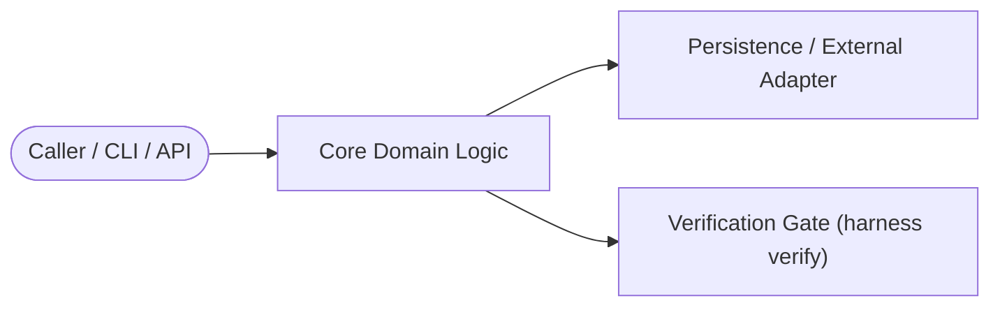

# Technical RFC: PDH v2.0 Domain-Agnostic & Player-Coach Orchestrator
**Status**: Proposed  
**Profile**: `python`  
**Orchestration Tier**: Tier 2 (Multi-Step Architecture & Implementation)  

---

## 1. Context & Problem Statement
Evolve PDH from a mobile-only KMP harness into a domain-agnostic SOTA harness driven by a Player-Coach Lead Orchestrator (@lead) with DAG dependency barriers, zero-loss Subagent Task Contracts, and universal multi-profile verification gates.

---

## 2. Proposed Architecture & Boundaries

### Key Design Decisions
1. **Separation of Concerns**: Core domain logic remains decoupled from I/O and presentation adapters.
2. **Backwards Compatibility**: Existing interfaces and schemas migrate cleanly without breaking callers.
3. **Failure Modes & Rollback**: All state mutations are atomic or guarded by fencing tokens.

---

## 3. Task Breakdown & Verification Plan
- [ ] Define interfaces and data contracts.
- [ ] Implement core logic and unit tests.
- [ ] Run `harness verify` and independent `@critic` review.
