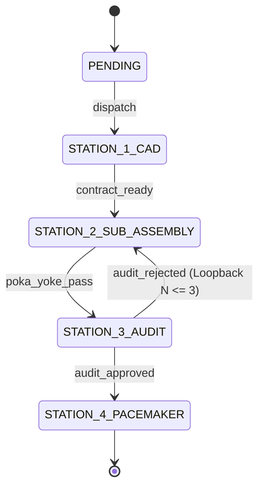
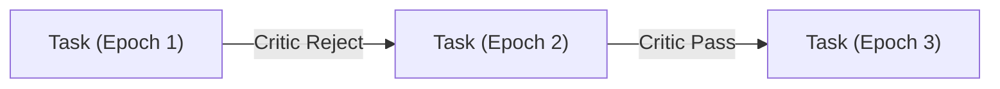

# Chapter 02: Core Architecture — The Microkernel

The core runtime of **Khoros** is built on the classic operating systems principle of **Mechanism vs. Policy separation**. 

The **Khoros Microkernel** provides only execution mechanics: atomic transaction serialization, state transition scheduling, worktree sandboxing, and resource metering. It contains zero knowledge of programming languages, framework conventions, or domain rules.

```
┌────────────────────────────────────────────────────────────────────────┐
│                        KHOROS MICROKERNEL RUNTIME                      │
├────────────────────────────────────────────────────────────────────────┤
│  ┌────────────────────────┐  ┌──────────────────────────────────────┐  │
│  │   Kernel Event Store   │  │       Dual-Graph State Engine        │  │
│  │   • Append-only WAL    │  │       • Logical State Machine        │  │
│  │   • BEGIN IMMEDIATE    │  │       • Physical Epoch Ledger        │  │
│  │   • CAS File Leases    │  │       • Anti-Deadlock Guard (N <= 3) │  │
│  └───────────┬────────────┘  └──────────────────┬───────────────────┘  │
│              │                                  │                      │
│              ▼                                  ▼                      │
│  ┌────────────────────────┐  ┌──────────────────────────────────────┐  │
│  │ Hybrid Worktree Engine │  │      Governor & Resource Ledger      │  │
│  │ • Private wt-<task-id> │  │      • Token Budgeting (TPM/RPM)     │  │
│  │ • Cache Symlinking     │  │      • Priority Queues (Q0 - Q3)     │  │
│  │ • Atomic FF Merges     │  │      • CONWIP Concurrency Caps       │  │
│  └────────────────────────┘  └──────────────────────────────────────┘  │
└────────────────────────────────────────────────────────────────────────┘
```

---

## 1. Zero-Contention Event-Sourced Ledger

In a multi-agent system where parallel squads perform code synthesis, run tests, and commit telemetry simultaneously, shared databases face **lock contention** and `SQLITE_BUSY` errors.

Khoros resolves this via an **Event-Sourced Zero-Contention Ledger Protocol** implemented in [`kernel/event_store.py`](../.harness/kernel/event_store.py).

### Transactional Protocol Rules:
1. **Decoupled LLM Execution**: Agent generation, test runs, and shell commands execute strictly outside database locks.
2. **`BEGIN IMMEDIATE` Atomic Writes**: Write transactions acquire write locks immediately upon opening, preventing snapshot-upgrade deadlocks under parallel worker execution.
3. **State Projections (Materialized Views)**: While every transition emits an immutable row to `kernel_events`, the kernel continuously updates a high-speed materialized projection table (`task_projections`), allowing sub-millisecond query performance without replaying the entire stream.

### Database DDL Schema
```sql
-- 1. Append-Only Event Stream
CREATE TABLE IF NOT EXISTS kernel_events (
    event_id INTEGER PRIMARY KEY AUTOINCREMENT,
    event_type TEXT NOT NULL,          -- TASK_DISPATCHED, POKA_YOKE_VIOLATION, etc.
    task_id TEXT NOT NULL,
    epoch INTEGER NOT NULL DEFAULT 1,
    payload_json TEXT NOT NULL,
    emitted_by TEXT NOT NULL,
    created_at REAL NOT NULL
);
CREATE INDEX IF NOT EXISTS idx_events_task_epoch ON kernel_events(task_id, epoch);

-- 2. State Projections (Materialized Active View)
CREATE TABLE IF NOT EXISTS task_projections (
    task_id TEXT PRIMARY KEY,
    status TEXT NOT NULL,              -- PENDING, STATION_1_CAD, STATION_2_SUB_ASSEMBLY, etc.
    archetype TEXT NOT NULL,
    owner TEXT,
    fencing_token INTEGER NOT NULL DEFAULT 0,
    current_epoch INTEGER NOT NULL DEFAULT 1,
    dependencies_json TEXT NOT NULL DEFAULT '[]',
    contract_hash TEXT NOT NULL,
    payload_json TEXT NOT NULL DEFAULT '{}',
    updated_at REAL NOT NULL
);

-- 3. Distributed File Lease Registry
CREATE TABLE IF NOT EXISTS file_leases (
    file_path TEXT PRIMARY KEY,
    task_id TEXT NOT NULL,
    holder_capsule TEXT NOT NULL,
    lease_expires_at REAL NOT NULL,
    fencing_token INTEGER NOT NULL,
    FOREIGN KEY(task_id) REFERENCES task_projections(task_id) ON DELETE CASCADE
);
```

---

## 2. Dual-Graph State Machine & Execution Runner

Software development is intrinsically iterative: code is written, verified, critiqued, and amended. However, classical DAG schedulers require strict acyclicity.

Khoros introduces the **Dual-Graph Resolution** in [`kernel/graph.py`](../.harness/kernel/graph.py):

### A. The Logical Graph (Cyclic State Machine)

The logical state machine defines allowed states and transitions:



- `PENDING` &rarr; `STATION_1_CAD` (`action: dispatch`)
- `STATION_1_CAD` &rarr; `STATION_2_SUB_ASSEMBLY` (`action: contract_ready`)
- `STATION_2_SUB_ASSEMBLY` &rarr; `STATION_3_AUDIT` (`action: poka_yoke_pass`)
- `STATION_3_AUDIT` &rarr; `STATION_4_PACEMAKER` (`action: audit_approved`)
- `STATION_3_AUDIT` &rarr; `STATION_2_SUB_ASSEMBLY` (`action: audit_rejected` &mdash; *Loopback Transition*)

### B. The Physical Graph (Unrolled Acyclic Execution Ledger)

The physical graph never loops back. Each pass through an iteration increments the task's execution epoch:



Every epoch attempt records its own diffs, tool traces, and gate checks immutably.

### C. Transition Guards & Anti-Deadlock Circuit Breaker
Every transition can be gated by a `TransitionGuard`. The loopback transition `audit_rejected` enforces:

```python
TransitionGuard(
    "CircuitBreakerMax3",
    lambda ctx: ctx.get("epoch", 1) < 3,
    failure_reason="Anti-deadlock circuit breaker tripped: exceeded 3 review cycles."
)
```

If a task fails audit 3 times, the guard fails, the **Andon Cord** is tripped, and the task transitions to `DEADLOCK_ESCALATED` for human triage.

### D. Barrier Synchronization (AND-Join)
The graph runner enforces multi-dependency synchronization before a task can be claimed:

```python
def check_barrier_sync(self, task_id: str) -> Tuple[bool, List[str]]:
    # All upstream tasks in dependencies_json must reach STATION_4_PACEMAKER or COMPLETED
    ...
```

---

## 3. Hybrid Git Worktree Concurrency Engine

Executing multiple agents within the same working copy causes file thrashing, unstaged diff collisions, and Git index lock exceptions.

Khoros implements **Hybrid Git Worktree Sandboxing** via [`kernel/worktree.py`](../.harness/kernel/worktree.py):

```
Root Workspace (/home/user/project)
├── .harness/
│   ├── cache/                  (Shared Heavy Caches)
│   │   ├── .venv/              (Python virtualenv)
│   │   ├── .gradle/            (Gradle dependency cache)
│   │   └── node_modules/       (NPM package cache)
│   └── worktrees/
│       ├── wt-task-101/  ◄──── (Private worktree on branch squad/task-101)
│       │   ├── .venv ─────────► (Symlinked to .harness/cache/.venv)
│       │   └── src/...
│       └── wt-task-102/  ◄──── (Private worktree on branch squad/task-102)
│           ├── .venv ─────────► (Symlinked to .harness/cache/.venv)
│           └── src/...
```

### Key Worktree Lifecycle Operations:
1. **Provisioning (`provision_worktree(task_id)`)**:
   - Creates an isolated worktree at `.harness/worktrees/wt-<task-id>` checked out to branch `squad/<task-id>`.
   - Automatically detects and symlinks heavy dependency caches (`.venv`, `.gradle`, `node_modules`, `target`), eliminating the 5–10 minute cold-start build penalty.
2. **Atomic Integration (`integrate_to_trunk(task_id)`)**:
   - Once all verification stations are cleared, merges `squad/<task-id>` into `main` using fast-forward (`git merge --ff-only`).
   - Automatically decommissions the worktree and deletes the ephemeral branch.
3. **Clean Teardown (`decommission_worktree(task_id)`)**:
   - If a task is aborted or the Andon Cord is pulled, the worktree is cleanly removed with zero residual diff contamination on `main`.

---

*Proceed to [03. Agent Capsules & Cognitive Memory](03-Agent-Capsules-and-Cognitive-Memory.md) to see how domain intelligence is packaged into modular capsules.*
