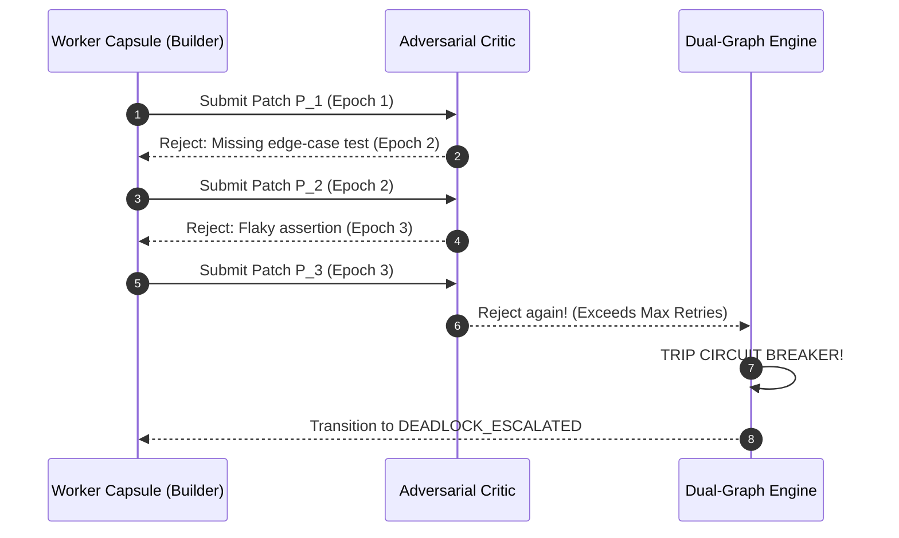

# Chapter 05: Team Organization & Squad Dynamics

> **Status: design only.** Squad assembly and the anti-deadlock engine are not implemented as a runtime. Our benchmark found no gain from multi-role workflows, and v4 keeps a single reviewer agent instead.** See [`.harness/EXPERIMENTAL.md`](../.harness/EXPERIMENTAL.md) and the [v4 RFC](../docs/rfc/khoros-v4.md).

Rather than maintaining rigid, permanent hierarchies or unconstrained chatrooms, **Khoros** organizes agents into **Dynamic Cellular Squads** assembled just-in-time around specific task archetypes.

```
┌────────────────────────────────────────────────────────────────────────┐
│                        DYNAMIC SQUAD ARCHETYPE CELLS                   │
├────────────────────────────────────────────────────────────────────────┤
│  UI Feature Squad:       Squad Lead + Mobile Builder + A11y Critic     │
│  Platform Squad:         Architect + Backend Builder + Security Critic │
│  Hotfix / RCA Squad:     RCA Lead + Bug Hunter + Verifier              │
└────────────────────────────────────────────────────────────────────────┘
```

---

## 1. The 3-Tier Squad Communication Protocol

Unstructured conversational chat between agents causes exponential context bloat ($O(N^2)$), hallucinated agreements, and lost-in-the-middle omissions.

Khoros enforces a strict **3-Tier Protocol**:

```
┌────────────────────────────────────────────────────────────────────────┐
│                        3-TIER SQUAD PROTOCOL                           │
├────────────────────────────────────────────────────────────────────────┤
│ 1. CONTROL PLANE: Typed Blackboard Ledger (SQLite WAL + CAS Leases)   │
│    - Task States: [PENDING -> CLAIMED -> AUDITING -> MERGED]           │
│    - Monotonic fencing tokens guarantee mutual exclusion               │
├────────────────────────────────────────────────────────────────────────┤
│ 2. DATA PLANE: Git Worktree Artifacts & File Leases                    │
│    - Inputs/Outputs are Git diffs, AST patches, and test reports       │
│    - Zero payload bloat in LLM context windows                         │
├────────────────────────────────────────────────────────────────────────┤
│ 3. SEMANTIC PLANE: Ephemeral Clarification Channels                    │
│    - Scoped, short-lived NL handshakes with strict TTL & token caps    │
│    - Builder asks Squad Lead for spec clarification (max 2 turns)      │
└────────────────────────────────────────────────────────────────────────┘
```

### Ephemeral Semantic Handshake:
When a worker encounters an ambiguity in the task contract, it does **not** engage in open-ended chat. It emits a structured event:

```json
{
  "event_type": "CLARIFICATION_REQUEST",
  "sender": "mobile-compose-builder",
  "recipient": "squad-lead",
  "payload": {
    "ambiguity_type": "MISSING_DESIGN_TOKEN",
    "query": "Color for disabled state on CardAction button is unspecified.",
    "proposed_fallback": "theme.colors.onSurfaceDisabled"
  }
}
```

The Squad Lead returns a single binary ACK or override. Once acknowledged, the thread terminates and the resolved value is appended to the contract amendment. The raw conversation is never retained in the worker's working memory.

---

## 2. Anti-Deadlock Circuit Breakers & Peer Review Guards

In the localized review loop between Builder and Adversarial Critic:



### The 4 Anti-Deadlock Invariants:
1. **Hard Iteration Limit ($N \le 3$)**:  
   The Builder $\leftrightarrow$ Critic review loop has a strict bound of $N=3$ rounds. If iteration 3 fails verification, the loop instantly trips the circuit breaker and transitions the task to `DEADLOCK_ESCALATED`.
2. **Contract Immutability & Signature**:  
   Acceptance criteria are signed with a SHA-256 hash by the Squad Lead. The Critic is programmatically barred from rejecting patches based on personal preferences not declared in the contract.
3. **Oscillation Distance Watchdog**:  
   The Kernel monitors the edit distance between alternating iterations:
   $$\mathcal{D}(P_k, P_{k-2}) < \epsilon \implies \text{Trip Circuit Breaker (Oscillatory Rework Detected)}$$
4. **Degrading Token Budget Quota**:  
   Each review iteration cuts the available token budget in half ($B_k = B_0 \cdot 2^{-(k-1)}$), forcing concise, targeted fixes rather than circular debates.

---

*Proceed to [06. The Kaizen Self-Improvement Engine](06-The-Kaizen-Self-Improvement-Engine.md) to explore causal credit attribution and automated distillation.*
