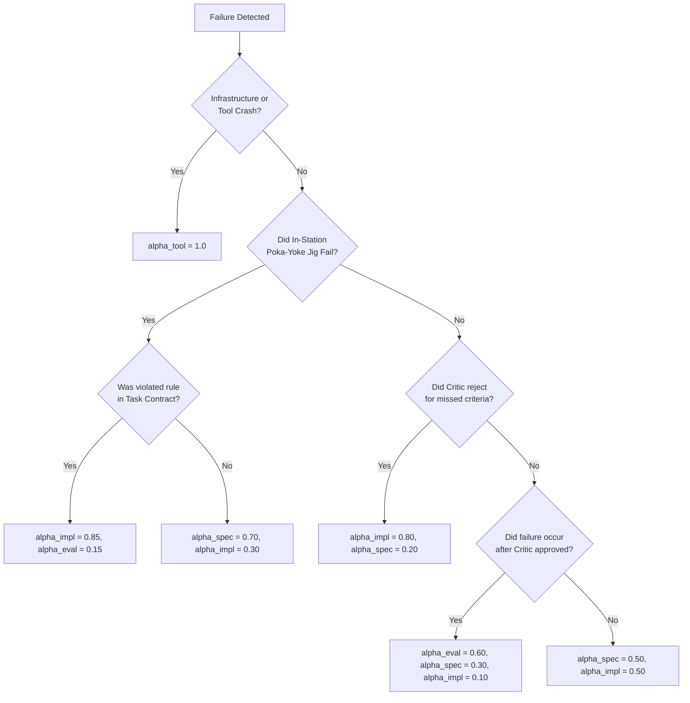

# Chapter 06: The Kaizen Self-Improvement Engine

> **Status: experimental, not wired into the runtime.** The "causal elimination DAG" is a short if/else returning fixed weight vectors (`kaizen/attribution.py`), and the distillation entry point is called only from tests, so no real failure has produced a proposal. Statements below that jigs "guarantee 100% mechanical enforcement" describe the intent only.** See [`.harness/EXPERIMENTAL.md`](../.harness/EXPERIMENTAL.md) and the [v4 RFC](../docs/rfc/khoros-v4.md).

The **Kaizen Engine** enables **Khoros** to continuously learn from failures and developer corrections without suffering from prompt drift, hallucinated constraints, or catastrophic forgetting.

```
┌────────────────────────────────────────────────────────────────────────┐
│                        THE KAIZEN DISTILLATION LOOP                    │
├────────────────────────────────────────────────────────────────────────┤
│  [Execution Traces] ──► [Causal Credit Attribution DAG]                │
│                                    │                                   │
│              ┌─────────────────────┴─────────────────────┐             │
│              ▼                                           ▼             │
│   Code Invariant (Ast Jig)                    Prompt / Semantic Rule   │
│   "Turn into AST check / unit test"           "Cap at Pareto K <= 12"  │
│              │                                           │             │
│              └─────────────────────┬─────────────────────┘             │
│                                    ▼                                   │
│                     [Quarantined Proposal Ledger]                      │
│                                    │                                   │
│                                    ▼                                   │
│                     [HITL Human Approval Gate]                         │
│                    `harness kaizen approve <id>`                       │
└────────────────────────────────────────────────────────────────────────┘
```

---

## 1. Causal Credit Attribution ($\vec{\alpha}$)

In multi-agent systems, naively blaming the last worker who touched code creates a **moral hazard**: Squad Leads generate vague specifications, Critics fail to catch regressions, and Builders take all the blame.

Khoros implements a **3-Stage Causal Elimination DAG** in [`kaizen/attribution.py`](../.harness/kaizen/attribution.py) to calculate the credit attribution vector:

$$\vec{\alpha} = \langle \alpha_{\text{spec}}, \alpha_{\text{impl}}, \alpha_{\text{eval}}, \alpha_{\text{tool}} \rangle, \quad \sum \alpha_k = 1.0$$



### Actionable Feedback per Attribution Component:
- **$\alpha_{\text{spec}} > 0.5$**: The Squad Lead's spec generation prompt receives a negative constraint exemplar.
- **$\alpha_{\text{impl}} > 0.5$**: The Builder Capsule synthesizes a deterministic AST jig or negative test fixture.
- **$\alpha_{\text{eval}} > 0.5$**: The Critic's checklist is updated to target the missed regression.

---

## 2. The Determinism Invariant (Code > Prompt)

Khoros operates under a fundamental meta-learning rule:

> **"Never keep in a prompt what can be enforced by a deterministic linter or test."**

If a failure pattern (e.g. hardcoded font sizes, missing null checks, raw color literals) occurs $\ge 2$ times in the failure logs, the Kaizen engine is designed to synthesize an AST regex check or unit test into `.harness/verifier.py` or `.harness/kernel/jigs.py`.

This permanently eliminates cognitive load from the prompt, would consume no prompt tokens, and would make the check mechanical once a jig exists (in practice only one placeholder jig was ever synthesized).

---

## 3. Pragmatic Prompt Optimization (Zero Runtime Tax)

Naively running prompt optimizers like DSPy MIPROv2 or Language Agent Tree Search (LATS) during live development incurs massive token costs (\$50–\$200/run) and high latency.

Khoros decouples prompt optimization into **two pragmatic tiers**:

### A. Selective Micro-LATS (Station 1 Spec CAD Only)
- Tree search is **never** used during code generation.
- It is applied solely to **Station 1 Contract Decomposition**:
  - Branching factor: $k=3$ candidate task breakdowns.
  - Deterministic Structural Value Function ($0$ LLM tokens):
    $$V(s) = w_1 \cdot \text{Acyclic}(DAG) + w_2 \cdot \text{FileScopeDisjointness} + w_3 \cdot \text{SchemaValidity}$$
  - Depth: limited to $d=2$.

### B. Offline Asynchronous DSPy Teleprompter
- Runs in the background during idle periods on **Queue Q3** (low priority).
- Evaluates past successful execution traces and selects canonical few-shot exemplars.
- The active developer loop pays **$0$ token overhead**.

---

## 4. Quarantined Proposal Ledger & HITL Promotion

To prevent indirect prompt injection (e.g. malicious dependencies emitting instructions into logs to weaken security rules) and persistent arbitrary code execution:

1. **Untrusted Trace Delimiters**: Trajectories ingested by Kaizen are treated as untrusted data (`<untrusted_trace>`).
2. **Quarantined Proposal Ledger (`kaizen_proposals`)**: All Kaizen mutations are logged in `QUARANTINED` status.
3. **Human Approval Gate**: Rule updates and synthesized scripts cannot be committed to trunk without explicit developer approval:

```bash
# List pending Kaizen proposals
bin/harness kaizen list

# Inspect and approve proposal
bin/harness kaizen approve <proposal-id>
```

---

*Proceed to [07. Developer Guide & CLI Reference](07-Developer-Guide-and-CLI-Reference.md) for complete CLI commands and authoring guides.*
