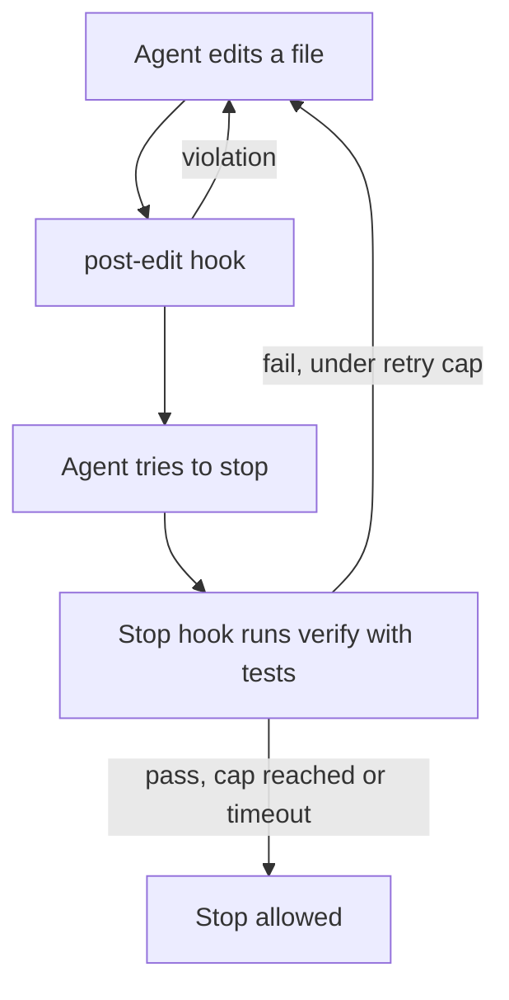

# Chapter 09: Khoros v4, an Evidence-Driven Harness

Summary of the [v4 RFC](../docs/rfc/khoros-v4.md). v4 keeps what the evidence supports and demotes the rest.

## Why

- Our benchmark (Sonnet fixed, `bench/results/*`) never showed Khoros raising solve rate. Cost was 1.05x to
  1.22x vanilla on the regression suites; the forced factory workflow cost 1.18x and took about 1.6x as long in
  the phase-2 pilot. A length-matched placebo `CLAUDE.md` did about as well as Khoros. Left free, agents used
  only `verify`. The regression suites are near ceiling (vanilla 94-100%) and the pilot is underpowered, so
  these are "no measured gain", not "proven no effect".
- The audit found `verify` was close to a no-op outside mobile code, the hooks were in a format Claude Code
  does not load, the telemetry used hardcoded token counts, and most of the kernel had no runtime caller.
- Outside evidence points the same way: context files cost about 20% more without raising success
  ([arXiv 2602.11988](https://arxiv.org/abs/2602.11988)), and a pre-completion verification pass was part of a
  harness-only gain on Terminal-Bench 2.0 ([LangChain](https://www.langchain.com/blog/improving-deep-agents-with-harness-engineering)), though that gain was not isolated per component.

## The design

| Part | Status | Notes |
|---|---|---|
| Stop-hook gate | Enforced | Runs `verify --changed` with tests; stderr report with how to fix; retry cap (3), test timeout (240 s), `KHOROS_GATE=off` escape hatch |
| Per-edit checks and loop nudge | Enforced | Static checks on the edited file; one nudge at 8 edits of a file |
| Short `CLAUDE.md` | Always loaded | Commands and non-inferable rules only |
| `long-task` skill | Opt-in | Blackboard task DAG, one task at a time, commit per task; for long or multi-session work |
| `khoros-reviewer` agent | Opt-in | Read-only, fresh-context review of a diff |
| Kernel graph, event store, worktrees, capsules, kaizen, skill mining, governor | Experimental | Not wired in; see [EXPERIMENTAL.md](../.harness/EXPERIMENTAL.md) |

Telemetry is honest: numbers the harness did not measure are not printed.

## Risks

Gate loops, slow test suites and false positives are handled by the retry cap, per-command timeouts and the
escape hatch. Every skipped check is reported as "skipped: reason" so a pass cannot hide a check that did not run.

## How v4 will be evaluated

Arms `vanilla`, `placebo` and `khoros` on the regression suites (harm and cost) and phase-2 scenarios (help).
Primary metric for task success is the hidden-test pass share against vanilla; cost ratio must stay under
1.15 with a 95% CI upper bound. Pilots are labelled inconclusive.

**v4, hard suite (2026-10-27, Sonnet, 2 reps × 6 tasks per arm, `bench/results/v4-hard-sonnet`):** Khoros solved 12/12 (vanilla 11/12, placebo 12/12, Khoros without the gate plugin 12/12). Its cost ratio is 0.97x vanilla (95% CI 0.86x–1.08x), against 1.06x–1.22x for v3.1, so H4 holds on this suite. Every Khoros run tested its code and finished on a verified state (vanilla 75%). The gate never had to block, because no run tried to stop on red tests. The suite is near ceiling, so it shows that v4 no longer costs extra, not that it helps. Whether the gate raises success (H5) needs the phase-2 scenarios, which have not been run on v4.

*Back to the [Wiki Home](Home.md).*
