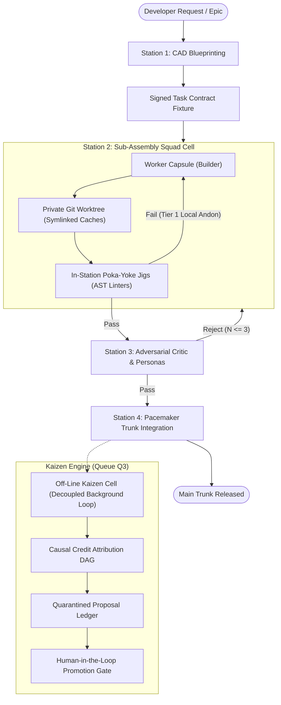

# Khoros (Χορός) Wiki

Welcome to the official documentation and knowledge base for **Khoros (Χορός)** *(formerly Personal Development Harness / PDH)*.

Named after the synchronized classical Greek ensemble led by the *Coryphaeus* (our Player-Coach Lead Orchestrator), **Khoros** is an autonomous software engineering operating system and microkernel designed to orchestrate single-agent and multi-agent squads with the mathematical discipline, precision tooling jigs, and quality controls of an industrial software factory.

---

## Wiki Table of Contents

| Chapter | Document | Description |
|---|---|---|
| **01** | [Evolution & Iterations](01-Evolution-and-Iterations.md) | Architectural lineage from v1.0 bash scripts to v2.0 Player-Coach DAG to v3.0 Self-Improving Factory. |
| **02** | [Core Architecture: The Microkernel](02-Core-Architecture-The-Microkernel.md) | Mechanism vs. Policy decoupling, SQLite WAL event store, dual-graph execution, and worktrees. |
| **03** | [Agent Capsules & Cognitive Memory](03-Agent-Capsules-and-Cognitive-Memory.md) | Declarative `capsule.yaml` manifests, 4-tier context budgeting, and Pareto rule bounds ($K \le 12$). |
| **04** | [The Lean Software Factory](04-The-Lean-Software-Factory.md) | Toyota Production System (TPS) applied to AI: 4 assembly stations, Poka-Yoke jigs, and Andon cords. |
| **05** | [Team Organization & Squad Dynamics](05-Team-Organization-and-Squad-Dynamics.md) | Cellular squad assembly, 3-tier squad protocol, and anti-deadlock circuit breakers. |
| **06** | [The Kaizen Self-Improvement Engine](06-The-Kaizen-Self-Improvement-Engine.md) | Causal credit attribution ($\vec{\alpha}$), Code > Prompt invariant, and quarantined proposal ledgers. |
| **07** | [Developer Guide & CLI Reference](07-Developer-Guide-and-CLI-Reference.md) | CLI commands, running verification gates, authoring capsules, and development workflows. |
| **08** | [Autonomous Capabilities & Library Hygiene](08-Autonomous-Capabilities-and-Library-Hygiene.md) | Dynamic tool synthesis, AST risk classification, clean-trunk canaries, evolutionary skill grammar, and generational GC. |

---

## Architectural Philosophy: The Three Invariants

**Khoros** is governed by three non-negotiable architectural invariants:

1. **The Separation Invariant (Mechanism vs. Policy)**:  
   The core engine (Kernel) must contain zero domain knowledge. It provides distributed OS mechanics (state machines, transactions, sandboxes). All domain logic, personas, and verification criteria live strictly in declarative Agent Capsules.

2. **The Determinism Invariant (Code > Prompt)**:  
   *"Never keep in a prompt what can be enforced by a deterministic linter or test fixture."* Mechanical violations (syntax, design tokens, secrets) must be stopped by computational AST jigs before reaching the LLM context window.

3. **The Zero-Defect Invariant (Quality at the Source / *Jidoka*)**:  
   Defects must be detected and corrected in-station at write time. Flawed artifacts cannot move downstream to pollute other squads or the main branch.

---

## System Topology Map

---

*Proceed to [01. Evolution & Iterations](01-Evolution-and-Iterations.md) to explore the full history and technical transitions of the harness.*
